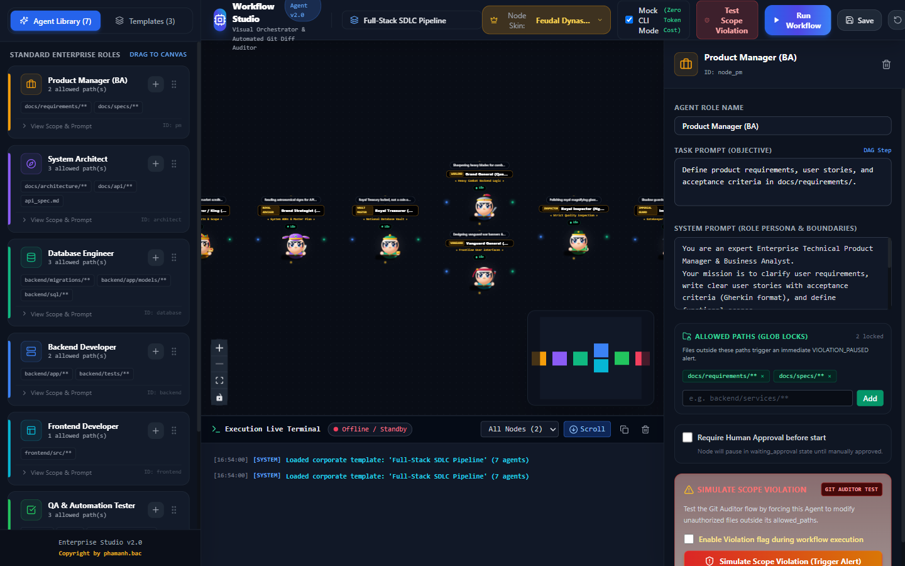
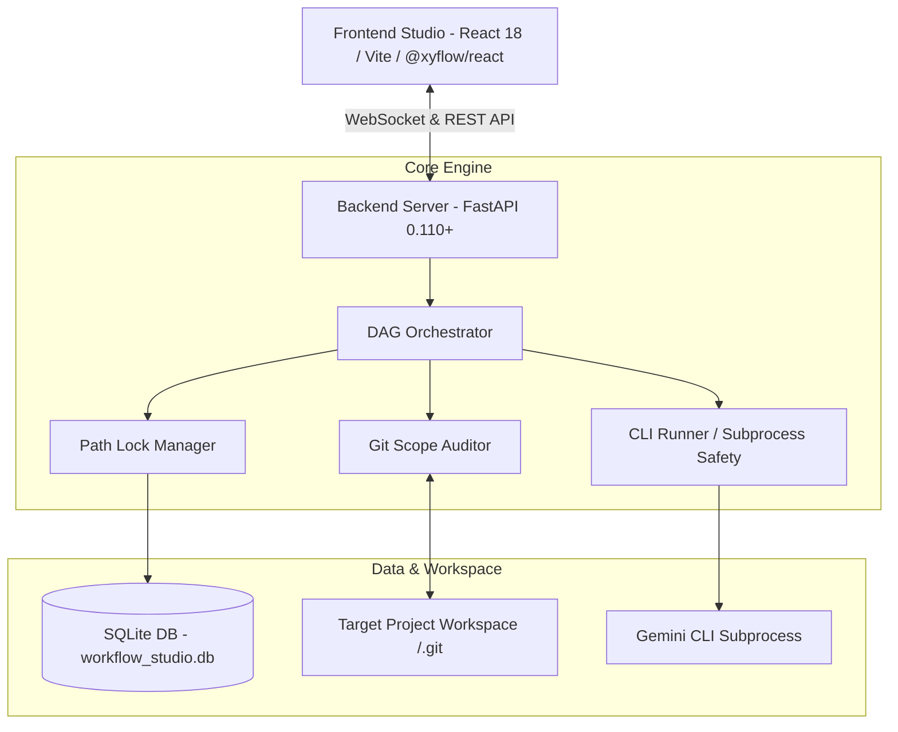
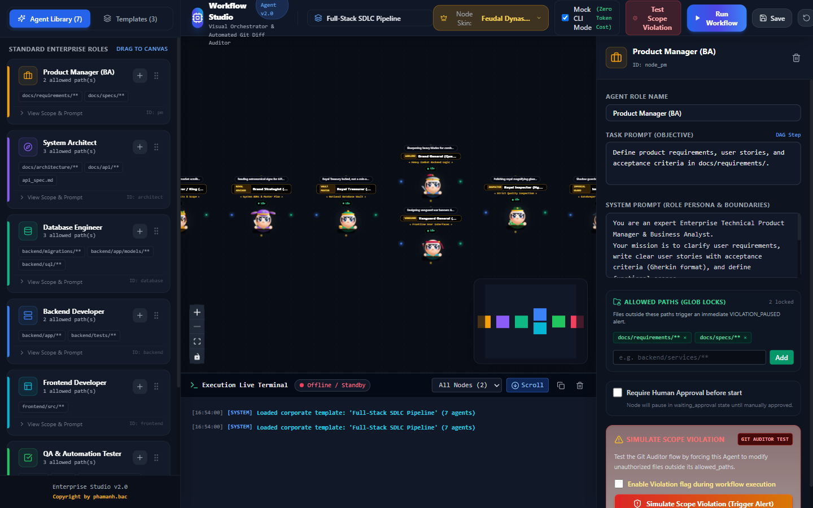

# 🚀 Gemini Workflow Studio (Enterprise Multi-Agent Edition)

<div align="center">



**Visual Drag-and-Drop Workflow Builder & Enterprise Multi-Agent Orchestrator**  
*Tự động hóa phối hợp đa Agent kỹ sư phần mềm (AI Software Engineers) trên Canvas tương tác thời gian thực với cơ chế Kiểm duyệt Git Diff (Scope Auditor) và Khóa đường dẫn (Path Lock Manager).*

[](https://www.python.org/)
[](https://fastapi.tiangolo.com/)
[](https://react.dev/)
[](https://vitejs.dev/)
[](https://reactflow.dev/)
[](backend/test_integration.py)
[](LICENSE)

</div>

---

## 📑 Mục Lục
1. [Giới Thiệu Tổng Quan](#-giới-thiệu-tổng-quan)
2. [Các Tính Năng Trọng Tâm](#-các-tính-năng-trọng-tâm)
3. [Kiến Trúc Hệ Thống (Architecture)](#-kiến-trúc-hệ-thống-architecture)
4. [Hình Ảnh Giao Diện Thực Tế](#-hình-ảnh-giao-diện-thực-tế)
5. [7 Mẫu Agent Presets Chuẩn Doanh Nghiệp](#-7-mẫu-agent-presets-chuẩn-doanh-nghiệp)
6. [3 Workflow Templates Sẵn Sàng](#-3-workflow-templates-sẵn-sàng)
7. [Khởi Động Nhanh (Quick Start)](#-khởi-động-nhanh-quick-start)
8. [Cấu Trúc Thư Mục Dự Án](#-cấu-trúc-thư-mục-dự-án)
9. [Bộ Kiểm Thử Tự Động (Automated Testing)](#-bộ-kiểm-thử-tự-động-automated-testing)
10. [Đặc Tả API & WebSocket](#-đặc-tả-api--websocket)

---

## 🌟 Giới Thiệu Tổng Quan

**Gemini Workflow Studio** là một nền tảng điều phối đa Agent (Multi-Agent Orchestration Platform) cho phép các nhóm phát triển phần mềm mô hình hóa quy trình phát triển sản phẩm (SDLC) dưới dạng đồ thị có hướng không chu trình (**DAG - Directed Acyclic Graph**). 

Hệ thống cho phép liên kết các kỹ sư AI chuyên biệt (Product Manager, System Architect, Backend Developer, Frontend Developer, QA Tester, Security Reviewer) làm việc đồng bộ trên một thư mục mã nguồn Git thực tế, đồng thời kiểm soát nghiêm ngặt vùng phạm vi can thiệp file để tránh xung đột mã nguồn.

---

## ⚡ Các Tính Năng Trọng Tâm

### 1. 🛡️ Cơ Chế Kiểm Duyệt Git Tự Động (Automated Git Scope Auditor)
- **Snapshot trước thực thi:** Tự động chụp trạng thái Git (`git status --porcelain`) trước khi bất kỳ Agent nào bắt đầu chạy.
- **Giám sát vi phạm vùng file:** So sánh `git diff` sau khi Agent hoàn tất. Nếu phát hiện Agent chỉnh sửa hoặc tạo mới file nằm ngoài danh sách `allowed_paths`, hệ thống lập tức:
  - Chuyển trạng thái node sang `VIOLATION_PAUSED`.
  - Tạm dừng toàn bộ pipeline phụ thuộc.
  - Phát tín hiệu cảnh báo WebSocket thời gian thực (`scope_violation_alert`) lên Studio UI.
- **Interactive Unified Diff Modal:** Giao diện trực quan hiển thị chính xác từng dòng code bị vi phạm (thêm `+`, bớt `-`). Người dùng có 2 lựa chọn:
  - **Revert (Khôi phục an toàn):** Hệ thống gọi `git restore` và `git clean -fd` để thu hồi sạch sẽ mọi thay đổi trái phép.
  - **Approve (Phê duyệt ngoại lệ):** Chấp thuận thay đổi, mở khóa và cho phép pipeline tiếp tục thực thi.
- **Hỗ trợ đa nền tảng (Cross-Platform):** Chuẩn hóa toàn bộ đường dẫn phân cách file theo định dạng POSIX (`/`), hoạt động hoàn hảo trên cả Windows, Linux và macOS.

### 2. 🔒 Bộ Quản Lý Khóa Đường Dẫn (Dynamic Path Lock Manager)
- Ngăn chặn triệt để tình trạng Race Condition khi nhiều Agent cùng chạy song song.
- Tự động phát hiện xung đột khi các Agent yêu cầu quyền ghi trên các đường dẫn lồng nhau (Nested Glob Patterns), ví dụ: `backend/**` và `backend/routers/**`.

### 3. 🎨 Visual Drag-and-Drop Studio (React Flow)
- Kéo thả node Agent từ thanh công cụ Preset vào Canvas tương tác.
- Tùy chỉnh trực tiếp: Tên vai trò, System Instruction, Nhiệm vụ cụ thể, `allowed_paths`, Timeout, Model Type (Gemini Flash, Pro, v.v.).
- Tự động sắp xếp luồng chạy dựa trên thuật toán **Topological Sort** với khả năng phát hiện lỗi vòng lặp (Circular Dependency Detection).

### 4. 📡 WebSocket Real-Time Terminal Streaming
- Kết nối hai chiều liên tục theo dõi tiến trình thực thi của từng Agent.
- Streaming logs trực tiếp từ terminal tiến trình subprocess CLI với encoding UTF-8 (chuẩn hóa font chữ tiếng Việt không bị lỗi).

---

## 🏗️ Kiến Trúc Hệ Thống (Architecture)



---

## 📸 Hình Ảnh Giao Diện Thực Tế

### 1. Canvas Thiết Kế Quy Trình Kéo Thả Trực Quan
Toàn bộ quy trình SDLC được biểu diễn dưới dạng các node liên kết chặt chẽ:


### 2. Cảnh Báo Vi Phạm Git Scope & Modal So Sánh Unified Diff
Khi Agent can thiệp vào file ngoài vùng cho phép, hệ thống tạm dừng và hiển thị Diff trực tiếp:


### 3. Quy Trình Hoàn Tất Thành Công & Trạng Thái Node Xanh Toàn Bộ
Bảng điều khiển trực quan cập nhật tiến độ, thời gian chạy và nhật ký chi tiết:


---

## 🤖 7 Mẫu Agent Presets Chuẩn Doanh Nghiệp

| STT | Agent Preset | Mô Tả Vai Trò | Phạm Vi File Cho Phép (`allowed_paths`) |
|:---:|:---|:---|:---|
| 1 | **Product Manager (PM)** | Định hình bài toán, viết PRD, User Stories và tiêu chí nghiệm thu | `docs/prd.md`, `docs/requirements.md` |
| 2 | **System Architect** | Thiết kế kiến trúc tổng thể, sơ đồ C4, API contracts | `docs/architecture.md`, `docs/api_spec.json` |
| 3 | **Database Engineer** | Thiết kế schema CSDL, viết migration script DDL | `backend/migrations/**`, `database/**` |
| 4 | **Backend Developer** | Xây dựng REST API, Business Logic, kết nối CSDL | `backend/**` |
| 5 | **Frontend Developer** | Xây dựng giao diện UI, kết nối API, Component React | `frontend/src/**` |
| 6 | **QA Tester** | Viết kịch bản kiểm thử tự động, End-to-End integration tests | `tests/**`, `backend/tests/**` |
| 7 | **Security Reviewer** | Quét lỗ hổng OWASP, kiểm tra bảo mật API và mã hóa | `docs/security_audit.md` |

---

## 📋 7 Workflow Templates Sẵn Sàng (1-Click Enterprise Pipelines)

Hệ thống được đóng gói sẵn **7 quy trình mẫu chuẩn** cho các tác vụ kỹ thuật phần mềm phổ biến trong doanh nghiệp:

| STT | Workflow Template | Số Node | Sơ Đồ DAG & Luồng Phối Hợp | Ứng Dụng Thực Tế |
|:---:|:---|:---:|:---|:---|
| 1 | **Full-Stack SDLC Pipeline** | 7 | PM ➔ Architect ➔ Database ➔ [Backend & Frontend song song] ➔ QA ➔ Security | Chu trình phát triển phần mềm toàn diện từ ý tưởng PRD đến kiểm toán an ninh xuất xưởng |
| 2 | **Fast Feature Pipeline** | 4 | Architect ➔ [Backend & Frontend song song] ➔ QA Tester | Triển khai nhanh tính năng mới đã có sẵn kiến trúc và schema |
| 3 | **Feature Enhancement Pipeline** | 5 | PM ➔ Architect ➔ [Backend & Frontend song song] ➔ QA Regression | Nâng cấp / bổ sung chức năng mới cho hệ thống hiện tại và kiểm thử hồi quy |
| 4 | **Security & Compliance Audit** | 3 | [Security Reviewer & QA Fuzzer song song] ➔ Architect Remediation | Rà soát lỗ hổng OWASP, kiểm thử bảo mật API / Fuzzing và lập kế hoạch khắc phục |
| 5 | **Code Review & Refactoring** | 5 | Architect ➔ [Backend & Frontend Refactor] ➔ QA ➔ Security | Tái cấu trúc mã nguồn, xử lý nợ kỹ thuật (Tech Debt) và tối ưu hóa hiệu năng |
| 6 | **Database Migration & Audit** | 3 | Database Engineer ➔ Backend Developer ➔ Security Reviewer | Nâng cấp CSDL an toàn, đồng bộ ORM models và kiểm định phòng chống rò rỉ dữ liệu / SQLi |
| 7 | **Bug Hotfix Pipeline** | 3 | Backend Developer ➔ QA Tester ➔ Security Reviewer | Phản ứng nhanh khắc phục sự cố khẩn cấp, kiểm thử hồi quy và chứng nhận an toàn |

---

## 🚀 Khởi Động Nhanh (Quick Start)

### Cách 1: Khởi Động 1 Cú Click Trên Windows (Khuyên Dùng) ⚡
Dự án đã tích hợp sẵn script [`start_studio.bat`](start_studio.bat) được tối ưu hóa riêng cho Windows:
- Nhấp đúp chuột vào file **`start_studio.bat`** tại thư mục gốc.
- Script sẽ tự động kiểm tra Python 3.10+, Node.js, cài đặt dependencies còn thiếu, bật Backend (port 8000), Frontend (port 5173) và tự động mở trình duyệt truy cập Studio tại:
  👉 **`http://localhost:5173`**

### Cách 2: Khởi Động Thủ Công Qua Terminal

#### 1. Yêu Cầu Môi Trường
- **Python:** 3.10 trở lên
- **Node.js:** v18 trở lên (khuyên dùng Node.js 20 hoặc 24 LTS)
- **Git:** Đã được cài đặt và cấu hình sẵn trên máy

#### 2. Khởi Động Backend
```bash
# Cài đặt thư viện Python
pip install -r requirements.txt

# Khởi chạy máy chủ FastAPI Backend
python -m uvicorn backend.main:app --host 127.0.0.1 --port 8000 --reload
```
*Tài liệu Swagger API có sẵn tại:* `http://localhost:8000/docs`

#### 3. Khởi Động Frontend
```bash
# Chuyển vào thư mục frontend
cd frontend

# Cài đặt dependencies
npm install

# Khởi chạy ứng dụng Vite React
npm run dev
```
*Giao diện Studio truy cập tại:* `http://localhost:5173`

---

## 📁 Cấu Trúc Thư Mục Dự Án

```text
Gemini-Workflow-Studio/
├── backend/
│   ├── app/                      # Application helpers & modules
│   ├── tests/
│   │   └── test_backend.py       # Bộ kiểm thử đơn vị & API routes (15 tests)
│   ├── cli_runner.py             # Tiến trình chạy Gemini CLI subprocess an toàn
│   ├── database.py               # Quản lý CSDL SQLite & Schema DDL
│   ├── git_auditor.py            # Git Scope Auditor & cơ chế Diff / Revert / Approve
│   ├── lock_manager.py           # PathLockManager chống xung đột đường dẫn song song
│   ├── main.py                   # FastAPI Application, REST Endpoints & WebSockets
│   ├── orchestrator.py           # DAG Orchestration & Topological Execution Engine
│   ├── presets.py                # Định nghĩa 7 Agent Presets & 3 Workflow Templates
│   ├── test_integration.py       # Bộ kiểm thử tích hợp chuyên sâu (6 tests)
│   └── requirements.txt          # Danh sách thư viện Python
├── frontend/
│   ├── src/
│   │   ├── components/           # Canvas, Node types, Modals, Terminal Drawer, Diff Modal
│   │   ├── hooks/                # WebSocket hooks, Workflow state hooks
│   │   ├── types/                # TypeScript interfaces chuẩn api_spec.md
│   │   ├── App.tsx               # Root Component
│   │   └── main.tsx              # Entry point
│   ├── package.json              # Dependencies Frontend (@xyflow/react, Tailwind, Lucide)
│   └── vite.config.ts            # Cấu hình Vite & Proxy
├── screenshots/                  # Ảnh chụp minh họa giao diện Studio
├── start_studio.bat              # Script khởi động tự động 1-click cho Windows
├── api_spec.md                   # Tài liệu đặc tả chuẩn REST API & WebSocket Events
├── project_context.md            # Tài liệu ngữ cảnh kỹ thuật & Thiết kế hệ thống
├── requirements.txt              # Thư viện Python gốc
└── README.md                     # Tài liệu hướng dẫn sử dụng chi tiết
```

---

## 🧪 Bộ Kiểm Thử Tự Động (Automated Testing)

Dự án sở hữu bộ test tự động toàn diện với **21/21 tests đạt PASS 100%**:

```bash
python -m pytest backend/tests/test_backend.py backend/test_integration.py -v
```

### Chi Tiết Độ Bao Phủ Kiểm Thử:
1. **`PathLockManager`:** Kiểm tra khóa đường dẫn đơn, giải phóng khóa, chặn chính xác các đường dẫn lồng nhau (`backend/**` vs `backend/routers/**`) và chuẩn hóa đường dẫn chéo hệ điều hành.
2. **`GitScopeAuditor`:** Giả lập Git repo thực tế, chỉnh sửa file hợp lệ và vi phạm, bắt chính xác lỗi vi phạm và hoàn tác sạch sẽ (`revert_unauthorized_files`).
3. **`DAG Orchestrator`:** Xác thực thứ tự chạy Topological Sort, phát hiện vòng lặp đồ thị, quản lý trạng thái chuyển đổi node.
4. **`Subprocess Safety`:** Đảm bảo CLI Runner có cơ chế timeout, hủy tiến trình cây con an toàn và encoding UTF-8 không lỗi font.
5. **`FastAPI Endpoints & WebSockets`:** Kiểm tra 100% các route REST và luồng heartbeat WebSocket.

---

## 🔌 Đặc Tả API & WebSocket

### Các REST Endpoints Chính
- `GET /api/presets`: Lấy danh sách 7 mẫu Agent tiêu chuẩn.
- `GET /api/templates`: Lấy danh sách 3 mẫu Workflow có sẵn.
- `POST /api/workflows`: Tạo mới workflow đồ thị DAG.
- `POST /api/workflows/{id}/execute`: Kích hoạt thực thi toàn bộ pipeline.
- `GET /api/executions/{id}`: Tra cứu trạng thái tiến trình thực thi.
- `POST /api/executions/{id}/violations/{node_id}/revert`: Khôi phục các file vi phạm phạm vi.
- `POST /api/executions/{id}/violations/{node_id}/approve`: Phê duyệt các thay đổi ngoại lệ.

### Chuẩn WebSocket Real-Time Events
- `node_status_update`: Thông báo thay đổi trạng thái node (`QUEUED`, `RUNNING`, `SUCCESS`, `VIOLATION_PAUSED`, `FAILED`).
- `terminal_log`: Truyền phát log terminal trực tiếp từ subprocess của Agent.
- `scope_violation_alert`: Phát cảnh báo khi phát hiện file vi phạm kèm Unified Diff.
- `lock_acquired` / `lock_released`: Thông báo trạng thái khóa đường dẫn trên tài nguyên.

---

## 📄 License

Dự án được phát hành theo giấy phép **MIT License**. Mọi đóng góp và cải tiến đều được hoan nghênh!
