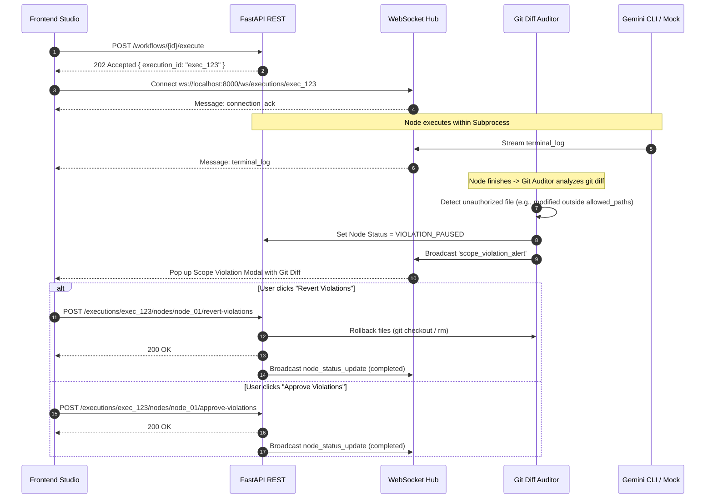

# Gemini Workflow Studio — API & WebSocket Specification

> **Document Version:** 2.0.0 (Enterprise Multi-Agent Edition)  
> **Status:** Official Specification  
> **Base URL (REST):** `http://localhost:8000/api/v1`  
> **Base URL (WebSocket):** `ws://localhost:8000/ws`  

---

## 1. Tổng quan giao tiếp hệ thống (Communication Architecture)

Hệ thống kết hợp **REST API** cho các tác vụ quản trị trạng thái và **WebSocket** cho luồng dữ liệu thời gian thực. Đặc biệt, phân hệ **Automated Git Diff Auditor** tích hợp chặt chẽ vào cả hai kênh để thông báo và giải quyết các vi phạm phạm vi code tức thì.



---

## 2. Chuẩn định dạng REST API (REST Endpoints)

### 2.1. Chuẩn phản hồi chung (Common Response Wrappers)

**Success Envelope:**
```json
{
  "success": true,
  "data": {},
  "message": "Operation completed successfully"
}
```

**Error Envelope:**
```json
{
  "success": false,
  "error": {
    "code": "SCOPE_VIOLATION_CONFLICT",
    "message": "Agent modified files outside authorized allowed_paths.",
    "details": null
  }
}
```

---

### 2.2. Nhóm Enterprise Presets & Workflow Templates

#### 2.2.1. Lấy danh sách 7 Enterprise Agent Presets
- **Endpoint:** `GET /presets`
- **Mô tả:** Trả về danh sách 7 vị trí chuẩn doanh nghiệp (PM, Architect, Database, Backend, Frontend, QA, Security) với cấu hình prompt và đường dẫn mẫu.
- **Response 200 OK:**
```json
{
  "success": true,
  "data": [
    {
      "id": "pm",
      "role_name": "Product Manager (BA)",
      "icon": "Briefcase",
      "color_theme": "#f59e0b",
      "default_system_prompt": "You are an expert Enterprise Technical Product Manager & Business Analyst...",
      "default_allowed_paths": ["docs/requirements/**", "docs/specs/**"],
      "default_read_only_paths": ["README.md"]
    },
    {
      "id": "architect",
      "role_name": "System Architect",
      "icon": "Compass",
      "color_theme": "#8b5cf6",
      "default_system_prompt": "You are a Principal Software & Systems Architect...",
      "default_allowed_paths": ["docs/architecture/**", "docs/api/**", "api_spec.md"],
      "default_read_only_paths": ["docs/requirements/**"]
    },
    {
      "id": "database",
      "role_name": "Database Engineer",
      "icon": "Database",
      "color_theme": "#10b981",
      "default_system_prompt": "You are a Senior Database Administrator & Data Modeler...",
      "default_allowed_paths": ["backend/migrations/**", "backend/app/models/**", "backend/sql/**"],
      "default_read_only_paths": ["docs/architecture/**", "api_spec.md"]
    },
    {
      "id": "backend",
      "role_name": "Backend Developer",
      "icon": "Server",
      "color_theme": "#3b82f6",
      "default_system_prompt": "You are a Senior Backend Software Engineer...",
      "default_allowed_paths": ["backend/app/**", "backend/tests/**"],
      "default_read_only_paths": ["docs/api/**", "api_spec.md", "backend/app/models/**"]
    },
    {
      "id": "frontend",
      "role_name": "Frontend Developer",
      "icon": "Layout",
      "color_theme": "#06b6d4",
      "default_system_prompt": "You are a Staff Frontend Engineer...",
      "default_allowed_paths": ["frontend/src/**"],
      "default_read_only_paths": ["api_spec.md", "docs/api/**"]
    },
    {
      "id": "qa",
      "role_name": "QA & Automation Tester",
      "icon": "CheckSquare",
      "color_theme": "#22c55e",
      "default_system_prompt": "You are a Lead QA Automation & Test Engineer...",
      "default_allowed_paths": ["tests/**", "e2e/**", "docs/test_reports/**"],
      "default_read_only_paths": ["backend/**", "frontend/**", "api_spec.md"]
    },
    {
      "id": "security",
      "role_name": "Security / Code Reviewer",
      "icon": "ShieldAlert",
      "color_theme": "#f43f5e",
      "default_system_prompt": "You are a Principal Application Security Engineer...",
      "default_allowed_paths": ["docs/security_audit/**", "SECURITY.md"],
      "default_read_only_paths": ["backend/**", "frontend/**", "docs/**"]
    }
  ]
}
```

#### 2.2.2. Lấy danh sách 3 Workflow Templates dựng sẵn
- **Endpoint:** `GET /templates`
- **Mô tả:** Trả về 3 template quy trình (`fullstack_sdlc`, `fast_feature`, `bug_hotfix`).
- **Response 200 OK:**
```json
{
  "success": true,
  "data": [
    {
      "id": "fullstack_sdlc",
      "name": "Full-Stack SDLC Pipeline",
      "description": "Enterprise end-to-end SDLC: PM -> Architect -> Database -> [Backend & Frontend in parallel] -> QA -> Security",
      "nodes_count": 7,
      "edges_count": 7
    },
    {
      "id": "fast_feature",
      "name": "Fast Feature Pipeline",
      "description": "Rapid parallel development: Architect -> [Backend & Frontend] -> QA Tester",
      "nodes_count": 4,
      "edges_count": 4
    },
    {
      "id": "bug_hotfix",
      "name": "Bug Hotfix Pipeline",
      "description": "Targeted fix and audit: Developer -> QA Tester -> Security Reviewer",
      "nodes_count": 3,
      "edges_count": 2
    }
  ]
}
```

#### 2.2.3. Tạo Workflow nhanh từ Template (1-Click Creation)
- **Endpoint:** `POST /workflows/from-template/{template_id}`
- **Mô tả:** Sinh ngay một Workflow hoàn chỉnh gồm tất cả Nodes, Edges, vị trí tọa độ Canvas và Preset cài sẵn.
- **Request Body:**
```json
{
  "name": "My New E-Commerce Checkout Pipeline",
  "description": "Created from Full-Stack SDLC Template"
}
```
- **Response 201 Created:** Trả về đối tượng Workflow hoàn chỉnh kèm Nodes và Edges.

---

### 2.3. Nhóm Quản lý Workflows (CRUD)

#### 2.3.1. Danh sách Workflows
- **Endpoint:** `GET /workflows`
- **Response 200 OK:** Trả về danh sách tóm tắt các workflows.

#### 2.3.2. Tạo mới Workflow tùy chỉnh
- **Endpoint:** `POST /workflows`
- **Request Body:**
```json
{
  "name": "Custom Microservice Pipeline",
  "description": "Pipeline for developing authentication microservice",
  "nodes": [
    {
      "id": "node_be",
      "preset_id": "backend",
      "role_name": "Auth Backend Dev",
      "node_type": "backend",
      "color_theme": "#3b82f6",
      "icon": "Server",
      "position_x": 250.0,
      "position_y": 100.0,
      "system_prompt": "You are a backend engineer...",
      "task_prompt": "Implement JWT auth in backend/app/api/auth.py",
      "allowed_paths": ["backend/app/api/auth.py", "backend/app/schemas/auth.py"],
      "read_only_paths": ["api_spec.md"],
      "require_human_approval": false
    }
  ],
  "edges": []
}
```
- **Response 201 Created:** Trả về Workflow vừa tạo.

#### 2.3.3. Lấy chi tiết Workflow
- **Endpoint:** `GET /workflows/{workflow_id}`
- **Response 200 OK:** Toàn bộ thông tin Canvas (Nodes, Edges, Configurations).

#### 2.3.4. Cập nhật Workflow & Canvas Coordinates
- **Endpoint:** `PUT /workflows/{workflow_id}`
- **Request Body:** Tương tự `POST /workflows`.
- **Response 200 OK:** Cập nhật thành công.

#### 2.3.5. Xóa Workflow
- **Endpoint:** `DELETE /workflows/{workflow_id}`
- **Response 200 OK:** `{ "success": true, "message": "Workflow deleted successfully" }`

---

### 2.4. Nhóm Thực thi & Điều phối (Execution Control)

#### 2.4.1. Kích hoạt thực thi
- **Endpoint:** `POST /workflows/{workflow_id}/execute`
- **Request Body:**
```json
{
  "mock_mode": true,
  "environment_vars": {
    "WORKSPACE_DIR": "d:/Project/Multi_Agent_Builder"
  }
}
```
- **Response 202 Accepted:** Trả về `{ execution_id, workflow_id, status: "running", mock_mode: true }`.

#### 2.4.2. Lấy trạng thái phiên thực thi (kèm dữ liệu vi phạm nếu có)
- **Endpoint:** `GET /executions/{execution_id}`
- **Response 200 OK:**
```json
{
  "success": true,
  "data": {
    "id": "exec_550e8400-e29b-41d4-a716-446655440000",
    "workflow_id": "wf_12345",
    "status": "running",
    "mock_mode": true,
    "start_time": "2026-10-16T11:45:00Z",
    "end_time": null,
    "nodes_status": [
      {
        "node_id": "node_be",
        "status": "violation_paused",
        "error_message": "Scope boundary violation: 1 unauthorized file modified.",
        "start_time": "2026-10-16T11:45:05Z",
        "end_time": null,
        "violation_data": {
          "unauthorized_files": ["frontend/src/App.tsx"],
          "diffs": [
            {
              "file_path": "frontend/src/App.tsx",
              "status": "modified",
              "diff_text": "--- a/frontend/src/App.tsx\n+++ b/frontend/src/App.tsx\n@@ -10,3 +10,4 @@\n+import { AuthModal } from './components/AuthModal';"
            }
          ]
        }
      }
    ],
    "active_locks": []
  }
}
```

#### 2.4.3. Dừng khẩn cấp phiên thực thi
- **Endpoint:** `POST /executions/{execution_id}/stop`
- **Response 200 OK:** `{ "success": true, "message": "Subprocesses terminated and locks cleared." }`

---

### 2.5. Nhóm Xử lý vi phạm Git (Git Diff Auditor Actions)

#### 2.5.1. Khôi phục (Revert) các file vi phạm
- **Endpoint:** `POST /executions/{execution_id}/nodes/{node_id}/revert-violations`
- **Mô tả:** Chạy `git checkout -- <file>` cho các file bị sửa và xóa các file mới tạo ngoài phạm vi. Sau đó tự động chuyển Node sang `completed`, giải phóng lock và đánh thức các nhánh downstream của DAG.
- **Request Body:**
```json
{
  "reverted_by": "User Admin",
  "comment": "Reverted frontend edits mistakenly made by backend agent."
}
```
- **Response 200 OK:**
```json
{
  "success": true,
  "data": {
    "node_id": "node_be",
    "status": "completed",
    "reverted_files": ["frontend/src/App.tsx"],
    "action": "reverted"
  },
  "message": "Unauthorized files successfully reverted. Workflow resumed."
}
```

#### 2.5.2. Chấp thuận (Approve) các file vi phạm
- **Endpoint:** `POST /executions/{execution_id}/nodes/{node_id}/approve-violations`
- **Mô tả:** Chấp nhận các thay đổi vượt quyền, lưu log kiểm duyệt, chuyển Node sang `completed` và kích hoạt các nhánh kế tiếp.
- **Request Body:**
```json
{
  "approved_by": "Tech Lead",
  "reason": "Backend agent correctly added required frontend client export."
}
```
- **Response 200 OK:**
```json
{
  "success": true,
  "data": {
    "node_id": "node_be",
    "status": "completed",
    "accepted_files": ["frontend/src/App.tsx"],
    "action": "approved"
  },
  "message": "Scope expansion approved by user. Workflow resumed."
}
```

#### 2.5.3. Xem chi tiết Git Diff vi phạm của một Node
- **Endpoint:** `GET /executions/{execution_id}/nodes/{node_id}/violations`
- **Response 200 OK:** Trả về đối tượng `violation_data` kèm full unified diff.

---

### 2.6. Nhóm Human Approval thông thường (Pre-Execution Gate)

#### 2.6.1. Phê duyệt cho Node chạy
- **Endpoint:** `POST /executions/{execution_id}/nodes/{node_id}/approve`
- **Response 200 OK:** Chuyển trạng thái từ `waiting_approval` sang `running`.

#### 2.6.2. Từ chối Node
- **Endpoint:** `POST /executions/{execution_id}/nodes/{node_id}/reject`
- **Response 200 OK:** Chuyển trạng thái sang `rejected`, ngắt các node phụ thuộc.

---

## 3. Đặc tả giao thức WebSocket (WebSocket Protocol)

### 3.1. Kết nối & Vòng đời
- **URL Endpoint:** `ws://localhost:8000/ws/executions/{execution_id}`
- **Heartbeat:** Gửi `{ "type": "ping" }` $\leftrightarrow$ Nhận `{ "type": "pong" }`.

### 3.2. Chuẩn Message Envelope
```typescript
interface WSMessageEnvelope<T = unknown> {
  type: WSMessageType;
  execution_id: string;
  timestamp: string; // ISO-8601
  payload: T;
}
```

---

### 3.3. Chi tiết các loại bản tin Server-to-Client

#### 3.3.1. `scope_violation_alert` (Trọng tâm Git Auditor)
Phát ra ngay khi Git Diff Auditor phát hiện Agent sửa hoặc tạo file nằm ngoài `allowed_paths`. Giao diện Frontend lập tức hiển thị Modal cảnh báo kèm Diff Viewer.

```json
{
  "type": "scope_violation_alert",
  "execution_id": "exec_550e8400-e29b-41d4-a716-446655440000",
  "timestamp": "2026-10-16T11:46:12Z",
  "payload": {
    "node_id": "node_be",
    "role_name": "Backend Developer",
    "allowed_paths": [
      "backend/app/**",
      "backend/tests/**"
    ],
    "unauthorized_files": [
      "frontend/src/App.tsx",
      "package.json"
    ],
    "diffs": [
      {
        "file_path": "frontend/src/App.tsx",
        "status": "modified",
        "diff_text": "--- a/frontend/src/App.tsx\n+++ b/frontend/src/App.tsx\n@@ -5,2 +5,3 @@\n+import { NewApi } from './api';\n"
      },
      {
        "file_path": "package.json",
        "status": "modified",
        "diff_text": "--- a/package.json\n+++ b/package.json\n@@ -15,2 +15,3 @@\n+    \"axios\": \"^1.6.0\",\n"
      }
    ],
    "detected_at": "2026-10-16T11:46:12Z"
  }
}
```

---

#### 3.3.2. `node_status_update`
Phát ra mỗi khi trạng thái Node thay đổi. Chú ý hỗ trợ trạng thái mới `violation_paused`.
```json
{
  "type": "node_status_update",
  "execution_id": "exec_550e8400-e29b-41d4-a716-446655440000",
  "timestamp": "2026-10-16T11:46:12Z",
  "payload": {
    "node_id": "node_be",
    "previous_status": "running",
    "current_status": "violation_paused",
    "error_message": "Agent modified files outside allowed_paths."
  }
}
```
*Các trạng thái hợp lệ:*
`idle`, `pending`, `queued_lock`, `waiting_approval`, `running`, `violation_paused`, `completed`, `failed`, `skipped`, `rejected`.

---

#### 3.3.3. `terminal_log`
Stream từng dòng output từ Gemini CLI / Mock Runner.
```json
{
  "type": "terminal_log",
  "execution_id": "exec_550e8400-e29b-41d4-a716-446655440000",
  "timestamp": "2026-10-16T11:45:30.450Z",
  "payload": {
    "node_id": "node_be",
    "stream_type": "stdout",
    "chunk": "[GIT-AUDIT] Running pre-execution status snapshot...\n",
    "seq_order": 1
  }
}
```

---

#### 3.3.4. `lock_acquired` & `lock_released`
```json
{
  "type": "lock_acquired",
  "execution_id": "exec_550e8400-e29b-41d4-a716-446655440000",
  "timestamp": "2026-10-16T11:45:20Z",
  "payload": {
    "node_id": "node_be",
    "locked_paths": ["backend/app/**"]
  }
}
```

---

#### 3.3.5. `workflow_status_update`
```json
{
  "type": "workflow_status_update",
  "execution_id": "exec_550e8400-e29b-41d4-a716-446655440000",
  "timestamp": "2026-10-16T11:47:00Z",
  "payload": {
    "status": "completed",
    "summary": {
      "total_nodes": 7,
      "completed_nodes": 7,
      "failed_nodes": 0,
      "violations_resolved": 1,
      "duration_seconds": 124.8
    }
  }
}
```

---

## 4. Shared TypeScript Interfaces

Toàn bộ các định nghĩa TypeScript này được chia sẻ trực tiếp giữa Backend và Frontend (`/frontend/src/types/`).

```typescript
/**
 * Shared Type Definitions for Gemini Workflow Studio (Enterprise Edition)
 */

// ============================================================================
// 1. Enums & Literal Types
// ============================================================================

export type AgentPresetKey =
  | 'pm'
  | 'architect'
  | 'database'
  | 'backend'
  | 'frontend'
  | 'qa'
  | 'security'
  | 'custom';

export type WorkflowTemplateKey =
  | 'fullstack_sdlc'
  | 'fast_feature'
  | 'bug_hotfix';

export type NodeExecutionStatus =
  | 'idle'
  | 'pending'
  | 'queued_lock'
  | 'waiting_approval'
  | 'running'
  | 'violation_paused'   // <-- Mới: Dừng khẩn cấp do vi phạm Git Scope
  | 'completed'
  | 'failed'
  | 'skipped'
  | 'rejected';

export type WorkflowExecutionStatus =
  | 'pending'
  | 'running'
  | 'completed'
  | 'failed'
  | 'paused'
  | 'stopped';

export type StreamType = 'stdout' | 'stderr' | 'system';

export type EdgeCondition = 'success' | 'always';

export type GitDiffFileStatus = 'modified' | 'added' | 'deleted' | 'renamed';

export type WSMessageType =
  | 'connection_ack'
  | 'node_status_update'
  | 'terminal_log'
  | 'lock_acquired'
  | 'lock_released'
  | 'approval_requested'
  | 'scope_violation_alert' // <-- Mới: Cảnh báo vi phạm Git Diff
  | 'workflow_status_update'
  | 'error_notification'
  | 'ping'
  | 'pong';

// ============================================================================
// 2. Presets & Templates Models
// ============================================================================

export interface AgentPreset {
  id: AgentPresetKey;
  role_name: string;
  icon: string;
  color_theme: string;
  default_system_prompt: string;
  default_allowed_paths: string[];
  default_read_only_paths: string[];
}

export interface WorkflowTemplate {
  id: WorkflowTemplateKey;
  name: string;
  description: string;
  nodes_count: number;
  edges_count: number;
}

// ============================================================================
// 3. Workflow & Graph Domain Models
// ============================================================================

export interface AgentNodeConfig {
  id: string;
  preset_id?: AgentPresetKey;
  role_name: string;
  node_type: string;
  icon: string;
  color_theme: string;
  position_x: number;
  position_y: number;
  system_prompt: string;
  task_prompt: string;
  allowed_paths: string[];   // Glob patterns: ["backend/app/**", "docs/*.md"]
  read_only_paths: string[];
  require_human_approval: boolean;
}

export interface WorkflowEdgeConfig {
  id: string;
  source_node_id: string;
  target_node_id: string;
  condition: EdgeCondition;
}

export interface Workflow {
  id: string;
  name: string;
  description?: string;
  template_id?: WorkflowTemplateKey | null;
  created_at: string;
  updated_at: string;
  nodes: AgentNodeConfig[];
  edges: WorkflowEdgeConfig[];
}

export interface WorkflowSummary {
  id: string;
  name: string;
  description?: string;
  nodes_count: number;
  edges_count: number;
  created_at: string;
  updated_at: string;
}

// ============================================================================
// 4. Git Diff Audit Models
// ============================================================================

export interface GitFileDiff {
  file_path: string;
  status: GitDiffFileStatus;
  diff_text: string;
}

export interface ScopeViolationData {
  unauthorized_files: string[];
  diffs: GitFileDiff[];
  detected_at?: string;
}

// ============================================================================
// 5. Execution & State Tracking Models
// ============================================================================

export interface FileLockItem {
  id: string;
  execution_id: string;
  node_id: string;
  path_pattern: string;
  locked_at: string;
}

export interface NodeExecutionState {
  node_id: string;
  status: NodeExecutionStatus;
  error_message?: string | null;
  violation_data?: ScopeViolationData | null;
  violation_action_at?: string | null;
  violation_action_by?: string | null;
  start_time?: string | null;
  end_time?: string | null;
  approved_at?: string | null;
  approved_by?: string | null;
}

export interface ExecutionSession {
  id: string;
  workflow_id: string;
  status: WorkflowExecutionStatus;
  mock_mode: boolean;
  start_time: string;
  end_time?: string | null;
  nodes_status: NodeExecutionState[];
  active_locks: FileLockItem[];
}

export interface ExecutionLogEntry {
  id?: number;
  execution_id: string;
  node_id: string;
  stream_type: StreamType;
  chunk: string;
  seq_order: number;
  timestamp: string;
}

// ============================================================================
// 6. REST API DTOs (Data Transfer Objects)
// ============================================================================

export interface ApiResponse<T = unknown> {
  success: boolean;
  data?: T;
  message?: string;
  error?: {
    code: string;
    message: string;
    details?: unknown;
  };
}

export interface CreateWorkflowDTO {
  name: string;
  description?: string;
  nodes: AgentNodeConfig[];
  edges: WorkflowEdgeConfig[];
}

export interface CreateFromTemplateDTO {
  name: string;
  description?: string;
}

export interface UpdateWorkflowDTO {
  name?: string;
  description?: string;
  nodes?: AgentNodeConfig[];
  edges?: WorkflowEdgeConfig[];
}

export interface ExecuteWorkflowDTO {
  mock_mode?: boolean;
  environment_vars?: Record<string, string>;
}

export interface RevertViolationsDTO {
  reverted_by: string;
  comment?: string;
}

export interface ApproveViolationsDTO {
  approved_by: string;
  reason: string;
}

export interface ApproveNodeDTO {
  approved_by: string;
  comment?: string;
}

export interface RejectNodeDTO {
  rejected_by: string;
  reason: string;
}

// ============================================================================
// 7. WebSocket Event Payloads
// ============================================================================

export interface WSMessageEnvelope<T = unknown> {
  type: WSMessageType;
  execution_id: string;
  timestamp: string;
  payload: T;
}

export interface WSScopeViolationAlertPayload {
  node_id: string;
  role_name: string;
  allowed_paths: string[];
  unauthorized_files: string[];
  diffs: GitFileDiff[];
  detected_at: string;
}

export interface WSNodeStatusUpdatePayload {
  node_id: string;
  previous_status: NodeExecutionStatus;
  current_status: NodeExecutionStatus;
  error_message?: string | null;
}

export interface WSTerminalLogPayload {
  node_id: string;
  stream_type: StreamType;
  chunk: string;
  seq_order: number;
}

export interface WSLockAcquiredPayload {
  node_id: string;
  locked_paths: string[];
}

export interface WSLockReleasedPayload {
  node_id: string;
  released_paths: string[];
}

export interface WSApprovalRequestedPayload {
  node_id: string;
  role_name: string;
  task_prompt: string;
  allowed_paths: string[];
}

export interface WSWorkflowStatusUpdatePayload {
  status: WorkflowExecutionStatus;
  summary?: {
    total_nodes: number;
    completed_nodes: number;
    failed_nodes: number;
    violations_resolved?: number;
    duration_seconds?: number;
  };
}

export interface WSErrorNotificationPayload {
  node_id?: string;
  error_code: string;
  message: string;
}
```
