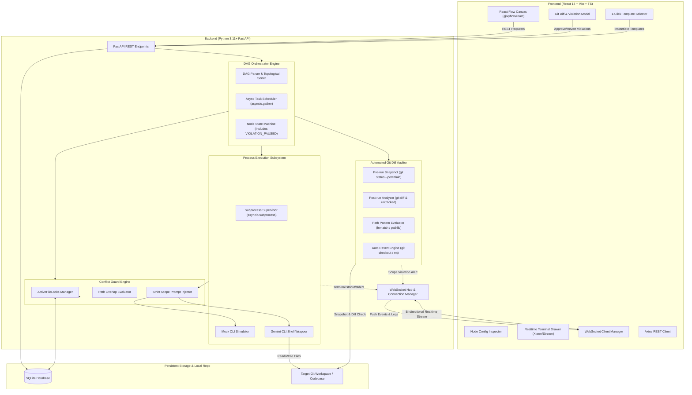
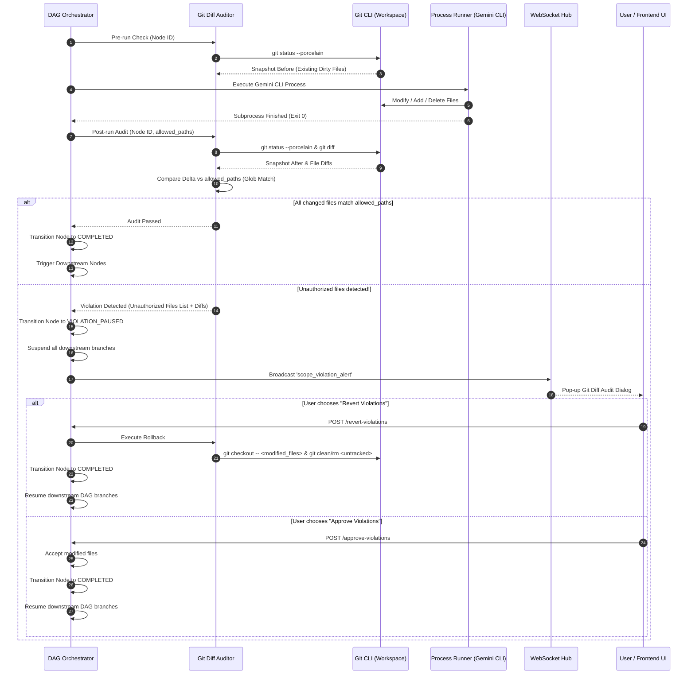
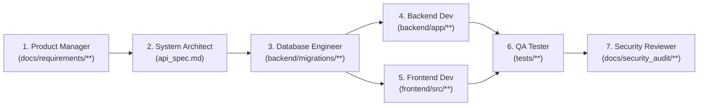
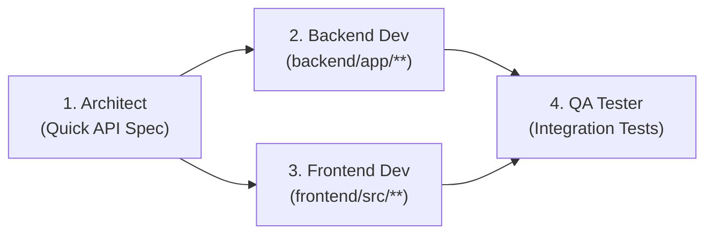
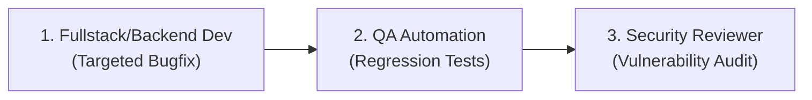
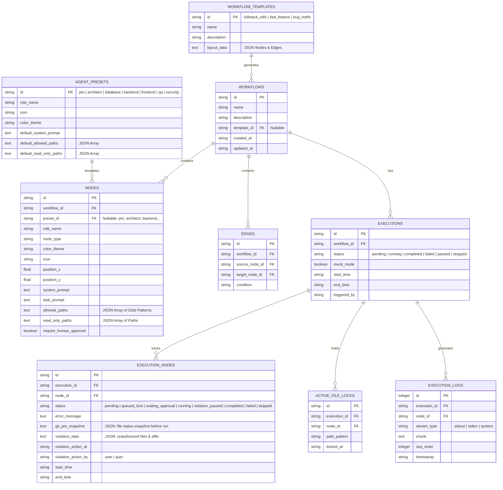

# Gemini Workflow Studio — Project Context & System Architecture

> **Document Version:** 2.0.0 (Enterprise Multi-Agent Edition)  
> **Target Audience:** Core Developers, System Architects, DevOps, Technical Product Managers  
> **Status:** Architecture Baseline & Specification  

---

## 1. Giới thiệu tổng quan (Executive Summary)

### 1.1. Sứ mệnh dự án
**Gemini Workflow Studio** là một nền tảng đồ họa trực quan (Visual Drag-and-Drop Workflow Builder & Multi-Agent Orchestrator) giúp điều phối nhiều phiên chạy **Gemini CLI** (Agentic AI CLI sessions) hoạt động đồng thời trên cùng một codebase theo mô hình phân công vai trò của một **công ty phần mềm chuyên nghiệp (Enterprise Software House)**.

### 1.2. Vấn đề giải quyết trong môi trường Multi-Agent
Khi áp dụng nhiều AI Agent độc lập cùng tham gia phát triển một sản phẩm:
1. **Phá vỡ ranh giới kiến trúc (Architectural Boundary Violation):** Một Agent Backend có thể vô tình sửa code Frontend, hoặc Agent Tester lại sửa trực tiếp Business Logic thay vì chỉ viết tests.
2. **Xung đột ghi đè tập tin (Race Conditions & Code Overwrite):** Chạy đồng thời mà không có khóa đường dẫn sẽ dẫn tới xung đột ghi file (Merge Conflicts hoặc hỏng file AST).
3. **Scope Drift & Hallucination ngoài tầm kiểm soát:** Dù prompt có ghi rõ phạm vi, LLM vẫn có thể tạo ra các file rác, file tạm ngoài thư mục được chỉ định.
4. **Thiếu quy trình kiểm soát chất lượng chuẩn SDLC:** Cần quy trình tuần tự kết hợp song song chuẩn mực: BA $\rightarrow$ Architect $\rightarrow$ Database $\rightarrow$ Backend/Frontend song song $\rightarrow$ QA $\rightarrow$ Security Reviewer.

### 1.3. Các trụ cột giải pháp cốt lõi
- **Automated Git Diff Auditor:** Trước khi Agent chạy, Backend chụp snapshot `git status --porcelain`. Sau khi Agent chạy xong, Backend phân tích delta `git diff` và đối chiếu với danh sách `allowed_paths` (hỗ trợ glob pattern như `backend/services/**`). Nếu vi phạm, lập tức chuyển Node sang trạng thái `VIOLATION_PAUSED`, tạm dừng đồ thị DAG, đẩy cảnh báo thời gian thực lên giao diện kèm diff chi tiết và cung cấp nút bấm **Revert** hoặc **Approve**.
- **Enterprise Agent Presets (7 Presets chuẩn doanh nghiệp):** Cung cấp sẵn các Agent mẫu (Product Manager, Architect, Database, Backend, Frontend, QA, Security) với system prompt, bảng màu, icon và đường dẫn chuẩn hóa.
- **Workflow Templates 1-Click:** Khởi tạo tức thì các quy trình chuẩn: *Full-Stack SDLC Pipeline*, *Fast Feature Pipeline*, *Bug Hotfix Pipeline*.
- **Conflict Guard (Virtual File Locking):** Kiểm tra giao thoa đường dẫn trước khi kích hoạt node, đưa vào hàng đợi chờ lock nếu có xung đột với các node đang chạy.
- **Strict Scope Prompt Injector:** Nối tự động khối quy tắc bắt buộc vào prompt gửi cho Gemini CLI.
- **Realtime WebSocket Streaming & Mock CLI Mode:** Stream terminal stdout/stderr thời gian thực; có chế độ Mock Mode để kiểm thử UI mà không tiêu tốn token.

---

## 2. Kiến trúc tổng thể hệ thống (System Architecture)

### 2.1. Sơ đồ kiến trúc mức cao (High-Level Architecture)



---

## 3. Cơ chế kiểm duyệt Git tự động (Automated Git Diff Auditor)

Đây là rào chắn an ninh vật lý thứ hai (sau Virtual Lock) ngăn ngừa hoàn toàn hiện tượng Agent phá vỡ quy định phạm vi code.

### 3.1. Quy trình kiểm duyệt theo chu kỳ thực thi của Node



### 3.2. Thuật toán phân tích Delta và đối soát Glob Pattern
1. **Delta Calculation:**
   - Tập hợp các file thay đổi bởi Node:
     $$\Delta_{\text{files}} = \text{Files}_{\text{after}} \setminus \text{Files}_{\text{before}}$$
   - Bao gồm: File được chỉnh sửa (`M`), File mới tạo (`??` hoặc `A`), File bị xóa (`D`).
2. **Glob Pattern Matching:**
   - Mỗi phần tử trong `allowed_paths` là một Glob Pattern tiêu chuẩn (ví dụ: `backend/services/**`, `frontend/src/components/*.tsx`).
   - Sử dụng thuật toán so khớp đường dẫn đệ quy:
     ```python
     import fnmatch
     from pathlib import PurePath

     def is_path_allowed(file_path: str, allowed_patterns: list[str]) -> bool:
         # Chuẩn hóa dấu phân cách thư mục sang dạng POSIX '/'
         normalized_path = PurePath(file_path).as_posix()
         for pattern in allowed_patterns:
             normalized_pattern = PurePath(pattern).as_posix()
             if fnmatch.fnmatch(normalized_path, normalized_pattern):
                 return True
             # Hỗ trợ dạng thư mục (ví dụ 'backend/' tương đương 'backend/**')
             if normalized_pattern.endswith('/') and normalized_path.startswith(normalized_pattern):
                 return True
         return False
     ```
3. **Danh sách vi phạm (`unauthorized_files`):**
   - Mọi file trong $\Delta_{\text{files}}$ mà `is_path_allowed(file) == False` sẽ được đưa vào danh sách vi phạm kèm nội dung trích xuất từ `git diff <file>`.

### 3.3. Cơ chế xử lý vi phạm (Revert vs Approve)
- **Khi Revert (`POST .../revert-violations`):**
  - Đối với file sửa đổi đã được git track: Chạy `git checkout -- <file>`.
  - Đối với file mới tạo chưa track (untracked): Xóa file khỏi ổ đĩa (`os.remove` hoặc `git clean -f <file>`).
  - Sau khi đưa workspace về trạng thái hợp lệ, Node chuyển sang `COMPLETED`, giải phóng khóa và cho phép các Node sau tiếp tục.
- **Khi Approve (`POST .../approve-violations`):**
  - Chấp nhận các thay đổi vượt quyền này (User ghi nhận đây là thay đổi hợp lệ phát sinh).
  - Ghi nhận lịch sử kiểm duyệt vào database (`violation_action_by`, `violation_action_at`), chuyển Node sang `COMPLETED` và mở khóa DAG.

---

## 4. Thư viện Agent Presets chuẩn công ty phần mềm (Enterprise Agent Presets)

Hệ thống định nghĩa sẵn **7 vị trí nhân sự chuẩn mực** trong quy trình công nghệ phần mềm:

| # | Role Key | Role Name | Icon | Color Theme | Default Allowed Paths | Default Read-Only Paths |
|---|---|---|---|---|---|---|
| 1 | `pm` | **Product Manager (BA)** | `Briefcase` | Amber (`#f59e0b`) | `["docs/requirements/**", "docs/specs/**"]` | `["README.md"]` |
| 2 | `architect` | **System Architect** | `Compass` | Purple (`#8b5cf6`) | `["docs/architecture/**", "docs/api/**", "api_spec.md"]` | `["docs/requirements/**"]` |
| 3 | `database` | **Database Engineer** | `Database` | Emerald (`#10b981`) | `["backend/migrations/**", "backend/app/models/**", "backend/sql/**"]` | `["docs/architecture/**", "api_spec.md"]` |
| 4 | `backend` | **Backend Developer** | `Server` | Blue (`#3b82f6`) | `["backend/app/**", "backend/tests/**"]` | `["docs/api/**", "api_spec.md", "backend/app/models/**"]` |
| 5 | `frontend` | **Frontend Developer** | `Layout` | Cyan (`#06b6d4`) | `["frontend/src/**"]` | `["api_spec.md", "docs/api/**"]` |
| 6 | `qa` | **QA & Automation Tester** | `CheckSquare` | Green (`#22c55e`) | `["tests/**", "e2e/**", "docs/test_reports/**"]` | `["backend/**", "frontend/**", "api_spec.md"]` |
| 7 | `security` | **Security / Code Reviewer** | `ShieldAlert`| Rose (`#f43f5e`) | `["docs/security_audit/**", "SECURITY.md"]` | `["backend/**", "frontend/**", "docs/**"]` |

### 4.1. Chi tiết System Prompt chuẩn cho từng Preset

#### 1. Product Manager (BA)
```text
You are an expert Enterprise Technical Product Manager & Business Analyst.
Your mission is to clarify user requirements, write clear user stories with acceptance criteria (Gherkin format), and define functional scopes.
Always organize specifications logically under docs/requirements/ and ensure all non-functional requirements (performance, accessibility, security) are explicitly documented.
Do NOT write application code or database migrations.
```

#### 2. System Architect
```text
You are a Principal Software & Systems Architect.
Your mission is to design scalable, fault-tolerant system architectures, clean API specifications (OpenAPI/AsyncAPI), and modular component topologies.
Document architecture decisions via ADRs (Architecture Decision Records) in docs/architecture/ and define strict interface schemas in api_spec.md.
Do NOT modify frontend view code or write application business logic.
```

#### 3. Database Engineer
```text
You are a Senior Database Administrator & Data Modeler.
Your mission is to design relational/NoSQL schemas, write clean migration scripts (Alembic/Flyway), optimize indexing strategies, and enforce data integrity constraints.
Ensure all tables include audit timestamps (created_at, updated_at) and foreign key relationships are strictly normalized.
Only write within backend/migrations/ and backend/app/models/.
```

#### 4. Backend Developer
```text
You are a Senior Backend Software Engineer specializing in Python FastAPI / Node.js.
Your mission is to implement robust REST & WebSocket APIs strictly adhering to api_spec.md.
Follow Clean Architecture, implement comprehensive error handling, input validation with Pydantic, and ensure zero SQL injection vulnerabilities.
Only write code in backend/app/ and backend/tests/.
```

#### 5. Frontend Developer
```text
You are a Staff Frontend Engineer specializing in React, TypeScript, TailwindCSS, and state management.
Your mission is to build highly responsive, accessible (WCAG 2.1 AA), and performant web interfaces.
Maintain strict TypeScript types matching the backend schema, build reusable atomic UI components, and handle loading/error states gracefully.
Only write code in frontend/src/.
```

#### 6. QA & Automation Tester
```text
You are a Lead QA Automation & Test Engineer.
Your mission is to develop end-to-end (Playwright/Cypress), integration (pytest/jest), and unit test suites that validate system behavior against acceptance criteria.
Never modify source code to make tests pass; instead, record detailed defect reports under docs/test_reports/.
Only write within tests/, e2e/, and docs/test_reports/.
```

#### 7. Security / Code Reviewer
```text
You are a Principal Application Security Engineer (AppSec) and Lead Code Auditor.
Your mission is to review all modified files across backend and frontend for OWASP Top 10 vulnerabilities, secret leakage, authorization bypasses, and adherence to clean code standards.
Generate comprehensive audit logs in docs/security_audit/ and recommend actionable remediation steps.
Do NOT modify application code directly.
```

---

## 5. Mẫu Workflow chuẩn hóa (Enterprise Workflow Templates)

Người dùng có thể tạo nhanh toàn bộ sơ đồ chỉ bằng 1 cú nhấp chuột từ 3 mẫu chuẩn hóa:

### 5.1. Template 1: Full-Stack SDLC Pipeline
Quy trình phát triển phần mềm toàn diện từ khâu phân tích tới nghiệm thu bảo mật.


*Đặc điểm:* BE và FE chạy song song (`asyncio.gather`) sau khi DB Engineer hoàn tất schema mà không gây xung đột nhờ đường dẫn độc lập hoàn toàn.

---

### 5.2. Template 2: Fast Feature Pipeline
Dành cho việc triển khai tính năng nhanh khi kiến trúc đã sẵn có.



---

### 5.3. Template 3: Bug Hotfix Pipeline
Quy trình sửa lỗi khẩn cấp, tập trung vào lập trình viên xử lý trực tiếp, kiểm thử và rà soát an toàn.



---

## 6. Lược đồ cơ sở dữ liệu chi tiết (Database Schema v2.0)

### 6.1. Entity Relationship Diagram (ERD)



### 6.2. Câu lệnh SQL DDL cập nhật

```sql
-- 1. Bảng lưu trữ cấu hình 7 Preset chuẩn
CREATE TABLE agent_presets (
    id TEXT PRIMARY KEY, -- 'pm', 'architect', 'database', 'backend', 'frontend', 'qa', 'security'
    role_name TEXT NOT NULL,
    icon TEXT NOT NULL,
    color_theme TEXT NOT NULL,
    default_system_prompt TEXT NOT NULL,
    default_allowed_paths TEXT NOT NULL,   -- JSON Array
    default_read_only_paths TEXT NOT NULL  -- JSON Array
);

-- 2. Bảng lưu trữ 3 Workflow Template dựng sẵn
CREATE TABLE workflow_templates (
    id TEXT PRIMARY KEY, -- 'fullstack_sdlc', 'fast_feature', 'bug_hotfix'
    name TEXT NOT NULL,
    description TEXT,
    layout_data TEXT NOT NULL              -- JSON cấu trúc nodes & edges
);

-- 3. Bảng Workflows
CREATE TABLE workflows (
    id TEXT PRIMARY KEY,
    name TEXT NOT NULL,
    description TEXT,
    template_id TEXT,
    created_at TEXT NOT NULL DEFAULT (datetime('now')),
    updated_at TEXT NOT NULL DEFAULT (datetime('now')),
    FOREIGN KEY(template_id) REFERENCES workflow_templates(id)
);

-- 4. Bảng Nodes
CREATE TABLE nodes (
    id TEXT PRIMARY KEY,
    workflow_id TEXT NOT NULL,
    preset_id TEXT,
    role_name TEXT NOT NULL,
    node_type TEXT NOT NULL,
    color_theme TEXT NOT NULL DEFAULT '#3b82f6',
    icon TEXT NOT NULL DEFAULT 'Bot',
    position_x REAL NOT NULL DEFAULT 0.0,
    position_y REAL NOT NULL DEFAULT 0.0,
    system_prompt TEXT NOT NULL DEFAULT '',
    task_prompt TEXT NOT NULL DEFAULT '',
    allowed_paths TEXT NOT NULL DEFAULT '[]',   -- JSON Array glob patterns
    read_only_paths TEXT NOT NULL DEFAULT '[]', -- JSON Array
    require_human_approval INTEGER NOT NULL DEFAULT 0,
    FOREIGN KEY(workflow_id) REFERENCES workflows(id) ON DELETE CASCADE,
    FOREIGN KEY(preset_id) REFERENCES agent_presets(id)
);

-- 5. Bảng Edges
CREATE TABLE edges (
    id TEXT PRIMARY KEY,
    workflow_id TEXT NOT NULL,
    source_node_id TEXT NOT NULL,
    target_node_id TEXT NOT NULL,
    condition TEXT NOT NULL DEFAULT 'success',
    FOREIGN KEY(workflow_id) REFERENCES workflows(id) ON DELETE CASCADE,
    FOREIGN KEY(source_node_id) REFERENCES nodes(id) ON DELETE CASCADE,
    FOREIGN KEY(target_node_id) REFERENCES nodes(id) ON DELETE CASCADE
);

-- 6. Bảng Executions
CREATE TABLE executions (
    id TEXT PRIMARY KEY,
    workflow_id TEXT NOT NULL,
    status TEXT NOT NULL DEFAULT 'pending',
    mock_mode INTEGER NOT NULL DEFAULT 0,
    start_time TEXT,
    end_time TEXT,
    triggered_by TEXT NOT NULL DEFAULT 'user',
    FOREIGN KEY(workflow_id) REFERENCES workflows(id) ON DELETE CASCADE
);

-- 7. Bảng Execution Nodes (Bao gồm dữ liệu Git Diff Audit)
CREATE TABLE execution_nodes (
    id TEXT PRIMARY KEY,
    execution_id TEXT NOT NULL,
    node_id TEXT NOT NULL,
    status TEXT NOT NULL DEFAULT 'pending', -- pending, queued_lock, waiting_approval, running, violation_paused, completed, failed, skipped
    error_message TEXT,
    git_pre_snapshot TEXT,                  -- JSON text lưu trạng thái git trước khi chạy
    violation_data TEXT,                    -- JSON text lưu danh sách file vi phạm & diff
    violation_action_at TEXT,
    violation_action_by TEXT,
    start_time TEXT,
    end_time TEXT,
    approved_at TEXT,
    approved_by TEXT,
    FOREIGN KEY(execution_id) REFERENCES executions(id) ON DELETE CASCADE,
    FOREIGN KEY(node_id) REFERENCES nodes(id) ON DELETE CASCADE
);

-- 8. Bảng Active File Locks
CREATE TABLE active_file_locks (
    id TEXT PRIMARY KEY,
    execution_id TEXT NOT NULL,
    node_id TEXT NOT NULL,
    path_pattern TEXT NOT NULL,
    locked_at TEXT NOT NULL DEFAULT (datetime('now')),
    FOREIGN KEY(execution_id) REFERENCES executions(id) ON DELETE CASCADE,
    FOREIGN KEY(node_id) REFERENCES nodes(id) ON DELETE CASCADE
);

-- 9. Bảng Execution Logs
CREATE TABLE execution_logs (
    id INTEGER PRIMARY KEY AUTOINCREMENT,
    execution_id TEXT NOT NULL,
    node_id TEXT NOT NULL,
    stream_type TEXT NOT NULL,
    chunk TEXT NOT NULL,
    seq_order INTEGER NOT NULL,
    timestamp TEXT NOT NULL DEFAULT (datetime('now')),
    FOREIGN KEY(execution_id) REFERENCES executions(id) ON DELETE CASCADE,
    FOREIGN KEY(node_id) REFERENCES nodes(id) ON DELETE CASCADE
);

-- Indexes tối ưu hiệu năng
CREATE INDEX idx_exec_nodes_status ON execution_nodes (execution_id, status);
CREATE INDEX idx_logs_stream ON execution_logs (execution_id, node_id, seq_order);
CREATE INDEX idx_locks_lookup ON active_file_locks (execution_id, path_pattern);
```
